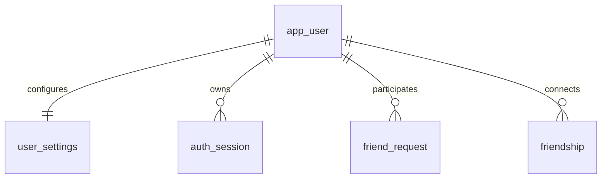
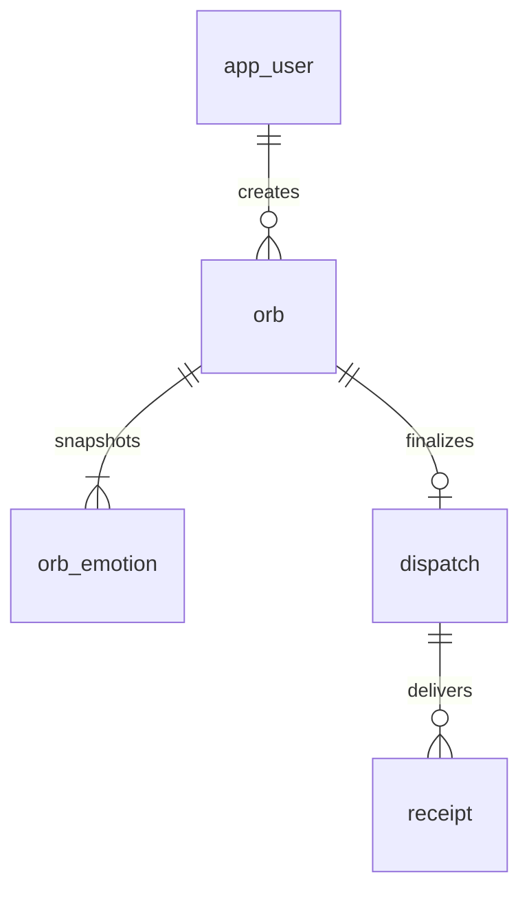
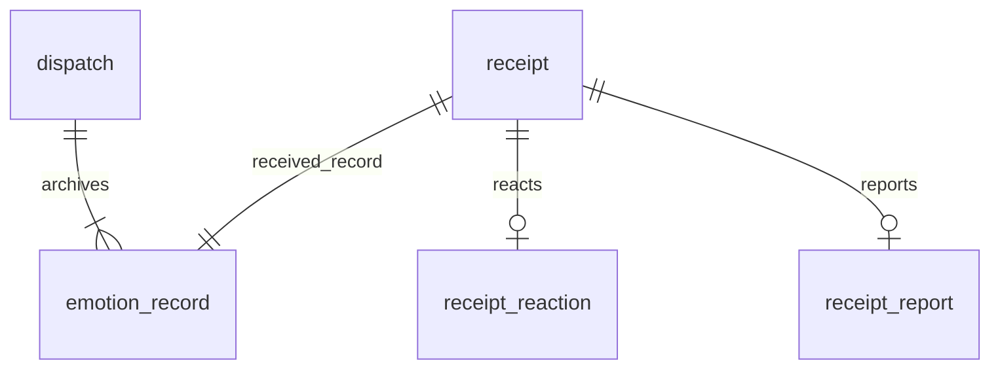
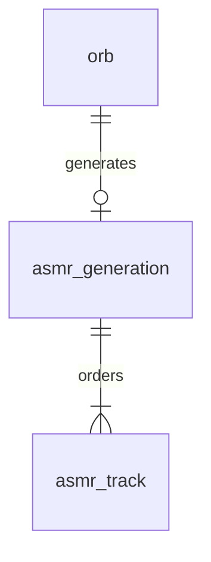
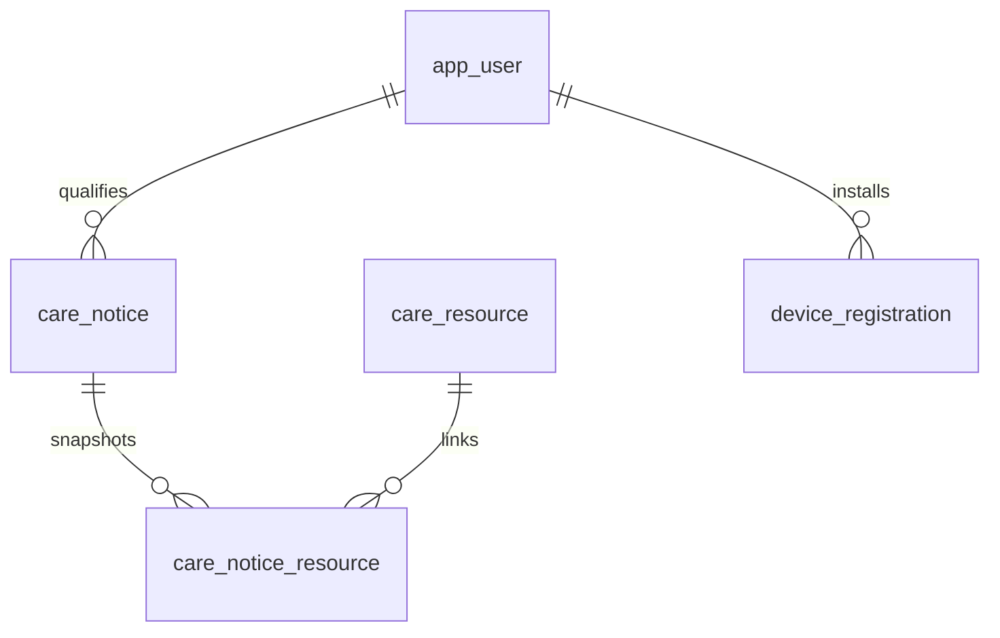

# EmOri DATABASE v0.5 — 최신 전달 반영 설계 검토안

## V8 생년월일 자기신고

`V8__birth_date_self_report.sql`은 `app_user.birth_date DATE NULL`을 추가하고 성인 상태 CHECK에 `SELF_REPORTED_19_PLUS`, `SELF_REPORTED_UNDER_19`를 더한다. 기존 사용자 값과 `VERIFIED_19_PLUS` 의미는 유지한다. 한국 시간 기준 생일·2월 29일 규칙은 서비스에서 계산한다. 음원 7곡은 Flyway seed가 아니라 운영자 등록 명령으로 영속 음원 볼륨과 `sound_catalog`에 저장된다.

> **v0.5 설계 및 8단계 구현 · 2026-11-18.** 색상 스냅샷과 사전 음원 카탈로그는 V7에 반영했다. 생년월일·복수 친구 전송은 합의 전 제안이다. 아래 V1~V6 대조본은 기존 스키마의 참고 자료다.

> **MVP 음원 정책 확정 · 2026-11-18.** 팀이 미리 준비한 무가사 음원 중 최대 1곡(15초 이하)을 구슬에 선택적으로 첨부한다. 신규 구슬은 생성 대기 없이 전송할 수 있고, AI 생성·재시도는 MVP 범위에서 제외한다. 기존 AI 음원은 이미 저장된 기록에서 계속 재생할 수 있도록 보존한다.

**8단계 구현 상태:** Flyway `V7__color_snapshots_and_sound_catalog.sql`에서 `orb_color_snapshot`, `sound_catalog`, nullable `orb.sound_id`를 추가했다. `orb_emotion`에는 선택 색의 첫 단어와 케어 여부를 저장해 기존 대표 색·날짜 집계 경로를 재사용한다. 네 단어와 영역은 새 스냅샷에 선택 순서대로 보존한다. 이전 AI 테이블과 파일은 유지한다. PostgreSQL 18에서 신규 설치·Stage 8 HTTP 흐름, V6 데이터가 있는 DB의 V7 업그레이드·기존 AI 트랙 조회를 검증했다.

## 변경 설계 제안 (PostgreSQL)

아래는 추가 설계다. 저장소에는 Flyway V1~V6이 있으며, 운영 DB 적용 상태는 확인하지 않았다. 구현 전에 실제 스키마의 컬럼명·제약을 대조해 신규 Flyway 마이그레이션으로 추가한다. 기존 마이그레이션 수정 금지.

| 대상 | 제안 컬럼·제약 | 설명 |
|---|---|---|
| app_user | `birth_date DATE NULL` 기본 NULL | 기존 계정 유지. 미래 날짜 거절은 KST 기준 서비스 검증. 서버가 성인 여부 계산; 자기신고이며 인증 증빙 아님. 접근·보존기간·변경정책 확인 |
| emotion_catalog | 기존 색·영역·단어 매핑 및 버전 | 유효한 색별 단어 4개, 명세 표와 대조. 고유 제약은 실제 기존 스키마 확인 |
| orb_emotion | 기존 선택 스냅샷을 확장해 색별 area와 단어 4개를 보존 | 정규화된 자식행 또는 JSONB를 실제 스키마에 맞게 선택. 구슬당 1~2개 서로 다른 색, 전송 후 불변. 사용자별 삭제가 콘텐츠를 삭제하지 않음 |
| sound_catalog (신규) | `id UUID PK`, `title TEXT NOT NULL`, `color VARCHAR NULL`, `duration_ms INTEGER NOT NULL CHECK (duration_ms BETWEEN 1 AND 15000)`, `storage_key TEXT NOT NULL UNIQUE`, `active BOOLEAN NOT NULL DEFAULT true`, `created_at TIMESTAMPTZ NOT NULL DEFAULT now()` | 제공 샘플 메타데이터. object key만 저장, URL은 접근 정책에 따라 생성. 유효 색 검증과 저장소 이용권한 확인 |
| orb | `sound_id UUID NULL REFERENCES sound_catalog(id) ON DELETE RESTRICT` | 샘플이 선택된 경우 하나만 연결. 카탈로그 비활성화해도 기존 구슬 재생 유지. 실제 orb 스키마에 맞춰 명명 |
| dispatch/receipt | 기존 전송 1건과 수신자별 receipt N건 | 친구 다중 전송 확장 제안. 수신 대상 유일성 `(dispatch_id, recipient_id)` 검토. 수신자별 열람·취소 직렬화 유지 |

친구 복수 허용 시 실제 `receipt` 제약과 서비스의 단일 수신자 가정부터 확인한다. 최대 인원·전체 실패/부분 성공이 미정이므로 경합 및 오류 규칙을 임의 확정하지 않는다. 열람/취소는 같은 대상 행을 `SELECT ... FOR UPDATE`로 잠그고 상태·5분을 잠금 안에서 재검증한다. 멱등성은 기존 사용자·메서드·경로·키 유일 제약 및 요청 해시를 유지한다. 익명 일일 한도 KST와 카운터 잠금은 기존 설계를 유지한다.

`birth_date`는 새 nullable 컬럼으로 추가 후 기존 사용자 UNKNOWN 유지. 과거 단어 선택 기록과 ASMR 작업·트랙·파일은 삭제하거나 샘플로 변환하지 않는다. 기존 데이터와 신규 색 매핑의 표현·케어 집계는 버전별로 분리하고 기획의 소급 적용 여부를 확인한다. 기존 AI 관련 테이블과 파일 경로를 유지하는 추가 마이그레이션으로 진행한다.

새 MVP 구슬에는 선택 시 `orb.sound_id` 하나만 설정한다. 과거 AI 구슬은 기존 플레이리스트 관계에서 읽는다. 첨부 시 활성 상태와 실제 재생 시간을 검증하고, 파일을 바꿀 때는 새 카탈로그 ID와 저장 키를 발급해 과거 구슬의 재생을 보존한다. 카탈로그 행과 파일은 배포 시 함께 준비한다.

운영 PostgreSQL 기준 `UUID`, `TIMESTAMPTZ`, `JSONB`, 부분 인덱스·행 잠금은 H2와 동작이 다를 수 있다. 신규 마이그레이션 및 열람/취소·멱등·한도 경합은 실제 PostgreSQL에서 검증한다.

**저장소 반영 메모:** 위 제안 중 색상 스냅샷과 음원 카탈로그는 V7에 적용했다. 생년월일과 복수 친구 전송은 미구현 제안이다. 아래 구현 대조본은 V1~V6을 설명한다.

## 이전 구현 대조본 — 변경된 항목은 위 검토안 우선

# EmOri 데이터베이스 설계

**구현 대조본 0.2 · 2026-11-16 · 기준 PRD/API v0.3, Flyway V1~V6**

정책 문서는 [PRD.md](PRD.md), 외부 계약은 [API.md](API.md)다. 이 문서는 현재 Spring Boot 구현 및 Flyway V1~V6과 대조했다. 공급자·운영 저장소 결정은 [ASMR_PROVIDER.md](ASMR_PROVIDER.md)에 정리했다.

아래 내부 모델과 잠금 방식에는 구현된 부분과 후속 제안이 함께 있다. 실제 적용 여부는 각 버전 마이그레이션과 검증 기록을 기준으로 확인한다.

## 1. 중요한 설계 선택

| 선택 | 이유와 효과 |
|---|---|
| PostgreSQL 운영 기준 | UUID·timestamptz·부분 인덱스·행 잠금·JSONB 지원을 기준으로 설계 |
| 구슬은 불변 콘텐츠, 아카이브는 사용자별 표시 상태 | OWN 기록 삭제가 수신 기록·플레이리스트 삭제로 이어지지 않음 |
| 전송 한 건에 수신 사본 0~3건 | SELF 0, 친구 1, 익명 1~3. 요청 한 번·대상별 열람·취소를 구분 |
| Target과 Receipt는 같은 receipt 행에서 서로 다른 ID로 표현 | API 역할을 분리하면서 열람·취소 상태를 두 테이블에 중복 저장하지 않음 |
| 구슬당 생성 작업 하나가 플레이리스트 역할도 담당 | Generation.id와 Playlist.id는 같은 UUID. 외부 응답은 각 DTO로 필요한 필드만 투영 |
| 사용자별 아카이브는 emotion_record에 저장 | 페이지 정렬·개인 삭제·생성/수신 기록을 같은 조회 경로에서 처리 |
| 상태의 단일 원천 유지 | Dispatch.status는 receipt 상태에서 계산, canCancel·휴식 active·케어 level도 조회 시 계산 |
| 기본 격리 READ COMMITTED + 명시적 잠금 | 짧은 트랜잭션에서 비즈니스 조건을 재검증. CHECK로 다른 행 개수를 검증하지 않음 |
| 익명 전송 경쟁은 사용자 UUID 정렬 잠금 | 설정·차단·한도·친구 변경과 매칭을 같은 잠금 규약으로 직렬화 |
| 비동기 처리는 DB outbox + 작업 lease | 프로세스 재시작과 중복 워커를 고려. Redis·별도 메시지 브로커를 MVP 의존성으로 추가하지 않음 |

## 2. 전체 관계

표시를 읽기 쉽게 영역별로 나눴다. 같은 이름은 같은 테이블이며 상세 FK는 §4를 따른다.

### 계정·관계

### 감정·전송

### 개인 기록·수신 반응

### ASMR

### 케어·운영

추가 내부 관계는 app_user → anonymous_block, anon_daily_usage, idempotency_request, outbox_event와 asmr_generation → asmr_track → asmr_outbox_event다. 카탈로그 테이블 emotion_catalog·reaction_catalog는 버전별 참조를 제공한다. V1~V6에는 총 27개 테이블이 있다.

## 3. 공통 타입·제약 표기

- 내부 신규 ID는 앱에서 생성한 UUID, API에서는 불투명 문자열. 카탈로그 ID는 명세 문자열이다. PK는 모두 NOT NULL. UUID 기본값은 DB 함수 대신 앱 생성으로 통일한다.
- 날짜는 date, 시각은 timestamptz(6), Java Instant, UTC 직렬화. KST 날짜는 거래 시 확보한 하나의 서버 시각을 변환한다. 서버 타임존에 의존하지 않는다.
- 표의 NULL=N은 NOT NULL, Y는 허용. 기본값 `없음`은 INSERT 시 필수, `NULL`은 기본 null이다. `now()`는 PostgreSQL 트랜잭션 시각이며 취소 마감에는 잠금 획득 후 DB 실시간 시각을 사용한다.
- 공통 `created_at`은 timestamptz(6), N, 기본 now(). `updated_at`은 같은 타입·NULL·기본값이며 UPDATE할 때 서비스가 갱신한다. 어느 테이블에 들어가는지는 각 표 아래에 명시한다.
- outbox_event의 PROCESSING이면 lease_token·lease_until 필수, 그 외 상태는 lease 필드를 NULL로 정리한다. attempt_count>=0 CHECK를 둔다.
- FK 기본 정책은 ON DELETE RESTRICT, ON UPDATE RESTRICT. API의 삭제는 명시한 논리 삭제 또는 관계 행 삭제다. 사용자·구슬·음원으로 확산되는 CASCADE를 만들지 않는다.
- status 등은 varchar + CHECK. enum 타입 추가 대신 마이그레이션으로 CHECK 목록을 변경한다. 외부 계약 상태와 내부 상태를 구별한다.
- CHECK는 필드 길이·범위·같은 행의 조건만 보장한다. 다른 행·다른 테이블의 건수와 소유권은 FK·고유 제약과 아래 트랜잭션이 함께 보장한다.
- PK·UNIQUE가 만드는 인덱스는 다시 생성하지 않는다. 아래 I는 추가 B-tree 인덱스이며 별도 표시 외 FK마다 일괄 인덱스를 추가하지 않는다.

## 4. 테이블 사전

### app_user

사용자 루트이자 경쟁 작업의 사용자별 잠금 행.

| 컬럼 | PostgreSQL 타입 | NULL | 기본값 | 의미·FK |
|---|---|---|---|---|
| id | uuid | N | 없음 | PK |
| login_id | varchar(20) | N | 없음 | 정규화된 공개 로그인·친구 코드 |
| password_hash | varchar(255) | N | 없음 | 알고리즘 정보 포함 해시 |
| nickname | varchar(20) | N | 없음 |  |
| adult_status | varchar(24) | N | 'UNKNOWN' | UNKNOWN / VERIFIED_19_PLUS / INELIGIBLE |
| adult_checked_at | timestamptz(6) | Y | NULL | 자격 갱신 시각 |

공통 컬럼 · created_at, updated_at

U(login_id). CHECK 정규식 ^[a-z0-9_]{4,20}$, 닉네임 trim 후 1~20자, adult_status 허용 목록. friendCode를 중복 컬럼으로 두지 않는다. 생년월일·증빙 원문은 확인 방식 결정 전 저장하지 않는다. 익명 후보 조회 I(adult_status,id).

### user_settings

가입 트랜잭션에서 사용자와 함께 1행 생성.

| 컬럼 | PostgreSQL 타입 | NULL | 기본값 | 의미·FK |
|---|---|---|---|---|
| user_id | uuid | N | 없음 | PK·FK app_user.id |
| anonymous_enabled | boolean | N | false |  |
| push_enabled | boolean | N | true |  |
| rest_mode | varchar(12) | N | 'OFF' | OFF / MANUAL / SCHEDULED |
| rest_starts_at | timestamptz(6) | Y | NULL |  |
| rest_ends_at | timestamptz(6) | Y | NULL |  |

공통 컬럼 · updated_at

CHECK OFF면 두 시각 NULL, MANUAL이면 starts NOT NULL·ends NULL, SCHEDULED면 둘 다 NOT NULL·ends>starts. 예약 날짜 경계는 서비스에서 KST 검증. active는 계산한다. adult_status와 anonymous_enabled의 일관성은 사용자 잠금 아래 서비스가 보장한다. 자격 미달 전환 시 익명 설정도 false.

### auth_session

제안한 인증 구현은 무작위 opaque access·refresh 토큰과 서버 세션이다. JWT 의존성은 선행 조건이 아니다.

| 컬럼 | PostgreSQL 타입 | NULL | 기본값 | 의미·FK |
|---|---|---|---|---|
| id | uuid | N | 없음 | PK |
| user_id | uuid | N | 없음 | FK app_user.id |
| access_token_hash | char(64) | N | 없음 | 무작위 토큰 SHA-256 |
| refresh_token_hash | char(64) | N | 없음 |  |
| access_expires_at | timestamptz(6) | N | 없음 |  |
| refresh_expires_at | timestamptz(6) | N | 없음 |  |
| revoked_at | timestamptz(6) | Y | NULL |  |
| rotation_number | integer | N | 0 |  |

공통 컬럼 · created_at, updated_at

U(access_token_hash), U(refresh_token_hash), CHECK access_expires_at>created_at, refresh_expires_at>=access_expires_at, rotation_number>=0. I(user_id,created_at DESC,id DESC), I(refresh_expires_at). 토큰 원문 저장 없음. refresh 시 같은 행을 잠그고 토큰 두 개·만료·rotation을 원자 교체. 이전 access·refresh는 무효. logout은 revoked_at을 설정해 양쪽 무효화. 생존기간은 설정값으로 정할 구현 결정이다.

### friend_request

이력은 유지하고 한 사용자 쌍의 진행 요청은 하나만 허용.

| 컬럼 | PostgreSQL 타입 | NULL | 기본값 | 의미·FK |
|---|---|---|---|---|
| id | uuid | N | 없음 | PK |
| from_user_id | uuid | N | 없음 | FK app_user.id |
| to_user_id | uuid | N | 없음 | FK app_user.id |
| status | varchar(12) | N | 'PENDING' | PENDING / ACCEPTED / DECLINED |
| decided_at | timestamptz(6) | Y | NULL |  |

공통 컬럼 · created_at

CHECK from<>to, 상태별 decided_at(PENDING NULL, 나머지 NOT NULL). 부분 U(LEAST(from_user_id,to_user_id),GREATEST(from_user_id,to_user_id)) WHERE status='PENDING'. I(to_user_id,created_at DESC,id DESC), I(from_user_id,created_at DESC,id DESC). ACCEPTED 이력과 현재 friendship 존재는 다를 수 있으며 친구 삭제가 과거 요청을 DECLINED로 바꾸지 않는다.

### friendship

한 사용자 쌍을 정렬하여 한 행으로 저장. 관계 삭제 시 이 행만 삭제.

| 컬럼 | PostgreSQL 타입 | NULL | 기본값 | 의미·FK |
|---|---|---|---|---|
| user_low_id | uuid | N | 없음 | 복합 PK·FK app_user.id |
| user_high_id | uuid | N | 없음 | 복합 PK·FK app_user.id |

공통 컬럼 · created_at

PK(user_low_id,user_high_id), CHECK user_low_id<user_high_id. I(user_high_id,created_at DESC,user_low_id), I(user_low_id,created_at DESC,user_high_id). 친구 목록은 양쪽 조회 UNION ALL 후 (created_at,상대 id)로 정렬. 삭제 후 재수락 시 새 created_at.

### emotion_catalog

버전별 감정 28개. 데이터는 마이그레이션으로 등록하고 과거 버전 보존.

| 컬럼 | PostgreSQL 타입 | NULL | 기본값 | 의미·FK |
|---|---|---|---|---|
| version | integer | N | 없음 |  |
| id | varchar(32) | N | 없음 | purple_01 등 |
| color | varchar(8) | N | 없음 |  |
| area | varchar(40) | N | 없음 |  |
| word | varchar(20) | N | 없음 |  |
| is_care | boolean | N | false |  |
| active | boolean | N | true |  |

공통 컬럼 · 없음

PK(version,id). CHECK version>0, color는 PRD 7색. v1 케어는 purple_01·purple_02·blue_02·blue_03·blue_04만 true. GET은 현재 버전만 반환한다. 마이그레이션에서 정확한 28개 매핑을 검증한다.

### reaction_catalog

MVP 반응 3종. 변경 시 기존 code는 유지한다.

| 컬럼 | PostgreSQL 타입 | NULL | 기본값 | 의미·FK |
|---|---|---|---|---|
| code | varchar(20) | N | 없음 | PK |
| label | varchar(40) | N | 없음 |  |
| emoji | varchar(16) | N | 없음 |  |
| active | boolean | N | true |  |

공통 컬럼 · 없음

HEART·HUG·CHEER 초기값. 코드 변경으로 과거 반응을 고아로 만들지 않는다.

### orb

초안도 존재하는 불변 감정 콘텐츠. 전송 여부는 dispatch 유무로 판단.

| 컬럼 | PostgreSQL 타입 | NULL | 기본값 | 의미·FK |
|---|---|---|---|---|
| id | uuid | N | 없음 | PK |
| author_id | uuid | N | 없음 | FK app_user.id |
| kind | varchar(8) | N | 없음 | SINGLE / MIXED |

공통 컬럼 · created_at

CHECK kind IN(SINGLE,MIXED). I(author_id,created_at DESC,id DESC). 소유자·감정 선택은 생성 후 변경하지 않는다. 감정을 바꾸면 새 초안이다. 별도 DRAFT/FINAL 상태를 중복 저장하지 않는다.

### orb_emotion

원본 매핑 스냅샷과 선택 순서. 같은 색 두 개 금지.

| 컬럼 | PostgreSQL 타입 | NULL | 기본값 | 의미·FK |
|---|---|---|---|---|
| orb_id | uuid | N | 없음 | 복합 PK·FK orb.id |
| position | smallint | N | 없음 | 복합 PK, 1 또는 2 |
| catalog_version | integer | N | 없음 |  |
| emotion_id | varchar(32) | N | 없음 |  |
| color | varchar(8) | N | 없음 |  |
| area | varchar(40) | N | 없음 |  |
| word | varchar(20) | N | 없음 |  |
| is_care | boolean | N | 없음 |  |

공통 컬럼 · 없음

PK(orb_id,position), U(orb_id,color), 복합 FK(catalog_version,emotion_id)→emotion_catalog(version,id), CHECK position IN(1,2). SINGLE 정확히 1행/MIXED 정확히 2행·순서 연속은 생성 트랜잭션으로 검증. 스냅샷은 클라이언트 값 대신 서버 카탈로그에서 복사한다. is_care도 생성 당시 기준이다.

### asmr_generation

구슬당 하나의 생성 작업이며 Playlist.id도 이 id를 사용.

| 컬럼 | PostgreSQL 타입 | NULL | 기본값 | 의미·FK |
|---|---|---|---|---|
| id | uuid | N | 없음 | PK |
| orb_id | uuid | N | 없음 | FK orb.id |
| status | varchar(20) | N | 'QUEUED' | QUEUED / PROCESSING / PARTIAL_FAILED / FAILED / READY |
| track_count | smallint | N | 3 |  |
| description | varchar(300) | Y | NULL | 작성자 입력. 수신 DTO 미노출 |
| detached_at | timestamptz(6) | Y | NULL | 음악 첨부 해제 표시 |

공통 컬럼 · created_at, updated_at

U(orb_id), CHECK track_count=3와 상태 목록. 설명은 전송 후에도 작성자 작업 조회에만 허용. detached_at 이후 플레이리스트는 Orb DTO에서 null이며 이전 콜백으로 복구하지 않는다. 새 생성은 같은 orb에서 불가, 새 초안 사용. status는 트랙 갱신 트랜잭션에서 계산해 저장한다.

### asmr_track

트랙별 결과·재시도·외부 요청 복구. 음원 bytes는 DB 밖 파일 저장소에 둔다.

| 컬럼 | PostgreSQL 타입 | NULL | 기본값 | 의미·FK |
|---|---|---|---|---|
| id | uuid | N | 없음 | PK |
| generation_id | uuid | N | 없음 | FK asmr_generation.id |
| position | smallint | N | 없음 |  |
| status | varchar(12) | N | 'QUEUED' |  |
| attempt | integer | N | 1 |  |
| provider | varchar(40) | Y | NULL |  |
| provider_job_id | varchar(255) | Y | NULL |  |
| provider_request_key | varchar(100) | Y | NULL |  |
| title | varchar(100) | Y | NULL |  |
| duration_ms | integer | Y | NULL |  |
| storage_key | varchar(512) | Y | NULL | 영구 객체 키, 임시 URL 저장 안 함 |
| error_code | varchar(40) | Y | NULL |  |
| attempt_deadline_at | timestamptz(6) | Y | NULL |  |

공통 컬럼 · created_at, updated_at

U(generation_id,position), U(provider,provider_job_id), U(provider,provider_request_key). CHECK position 1~3, attempt>=1, 상태 QUEUED/PROCESSING/FAILED/READY. READY면 title·storage_key·duration_ms NOT NULL, duration_ms BETWEEN 1 AND 30000, error_code NULL. 미완료는 결과 필드 NULL, FAILED에는 error_code 필수. I(status,attempt_deadline_at). 공급자별 부분 결과는 provider_job_id로 복구하며 실제 bytes 길이·무보컬 품질은 공급자/서비스 검증 대상이다.

### asmr_outbox_event

V6은 기존 V5 푸시 outbox의 CHECK를 변경하지 않고 ASMR 전용 작업 큐를 추가한다. `id` PK, `track_id` FK, `attempt`, `status`, `available_at`, `lease_token`, `lease_until`, `created_at`, `updated_at`을 저장한다. U(track_id,attempt), I(status,available_at,id), I(status,lease_until). 상태는 PENDING/PROCESSING/SENT/FAILED이며 PROCESSING에서만 lease 값이 존재한다. 공급자 작업 ID와 10분 기한은 `asmr_track`에 보존한다.

### dispatch

초안 한 건의 경로 확정. 최초 수신 인원은 취소 후에도 유지.

| 컬럼 | PostgreSQL 타입 | NULL | 기본값 | 의미·FK |
|---|---|---|---|---|
| id | uuid | N | 없음 | PK |
| orb_id | uuid | N | 없음 | FK orb.id |
| route | varchar(12) | N | 없음 | SELF / FRIEND / ANONYMOUS |
| sent_at | timestamptz(6) | N | 없음 | SELF도 확정 시각 |
| cancel_until | timestamptz(6) | Y | NULL |  |
| recipient_count | smallint | N | 없음 |  |

공통 컬럼 · 없음

U(orb_id). CHECK SELF면 recipient_count=0·cancel_until NULL, FRIEND면 1, ANONYMOUS면 1~3이며 양쪽 cancel_until=sent_at+interval '5 minutes'. sender는 orb.author_id로 결정. status는 SELF SAVED, 사본 모두 취소 CANCELLED, 일부 PARTIALLY_CANCELLED, 나머지 SENT로 계산. I(sent_at,id). 수신 행 개수 일치는 전송 트랜잭션이 보장한다.

### receipt

수신자 사본과 Target 상태의 단일 원천. 내부 recipient_id는 익명 DTO에 노출 금지.

| 컬럼 | PostgreSQL 타입 | NULL | 기본값 | 의미·FK |
|---|---|---|---|---|
| id | uuid | N | 없음 | PK, 수신자용 receiptId |
| target_id | uuid | N | 없음 | 발신자용 targetId |
| dispatch_id | uuid | N | 없음 | FK dispatch.id |
| recipient_id | uuid | N | 없음 | FK app_user.id |
| received_at | timestamptz(6) | N | 없음 |  |
| opened_at | timestamptz(6) | Y | NULL |  |
| cancelled_at | timestamptz(6) | Y | NULL |  |
| action_token_hash | char(64) | Y | NULL |  |
| action_expires_at | timestamptz(6) | Y | NULL |  |
| action_closed_at | timestamptz(6) | Y | NULL |  |

공통 컬럼 · 없음

U(target_id), U(dispatch_id,recipient_id). CHECK opened_at과 cancelled_at 동시 NOT NULL 금지. action hash·expires 둘 다 NULL 또는 둘 다 NOT NULL. 발급은 익명 최초 열람에서만, 하나의 사본에 토큰 재발급 없음. I(recipient_id,received_at DESC,id DESC) WHERE cancelled_at IS NULL, 미열람 부분 I(recipient_id,received_at DESC,id DESC) WHERE cancelled_at IS NULL AND opened_at IS NULL. 상태는 cancelled_at NULL이면 DELIVERED. 취소 사본은 물리 보존·모든 수신 조회에서 404 또는 필터 제외.

### emotion_record

한 사용자의 아카이브 항목. 콘텐츠·수신 상태와 삭제를 분리.

| 컬럼 | PostgreSQL 타입 | NULL | 기본값 | 의미·FK |
|---|---|---|---|---|
| id | uuid | N | 없음 | PK |
| owner_id | uuid | N | 없음 | FK app_user.id |
| dispatch_id | uuid | N | 없음 | FK dispatch.id |
| receipt_id | uuid | Y | NULL | FK receipt.id, OWN이면 NULL |
| side | varchar(8) | N | 없음 | OWN / RECEIVED |
| recorded_at | timestamptz(6) | N | 없음 |  |
| deleted_at | timestamptz(6) | Y | NULL | OWN 본인 숨김 |

공통 컬럼 · 없음

부분 U(dispatch_id) WHERE side='OWN', U(receipt_id). CHECK OWN이면 receipt_id NULL, RECEIVED면 receipt_id NOT NULL·deleted_at NULL. receipt의 전송·수신자와 record의 dispatch·owner 일치, OWN owner=orb.author는 전송 트랜잭션에서 검증. I(owner_id,recorded_at DESC,id DESC) WHERE deleted_at IS NULL, I(owner_id,side,recorded_at DESC,id DESC) WHERE deleted_at IS NULL. orb는 dispatch를 통해 조회해 중복 orb_id를 두지 않는다.

### receipt_reaction

수신 사본당 반응 최대 하나.

| 컬럼 | PostgreSQL 타입 | NULL | 기본값 | 의미·FK |
|---|---|---|---|---|
| receipt_id | uuid | N | 없음 | PK·FK receipt.id |
| code | varchar(20) | N | 없음 | FK reaction_catalog.code |

공통 컬럼 · created_at

PK로 한 번 제한. 익명·본인 사본·유효 토큰·active 반응 여부는 receipt 잠금 아래 검증. 발신 반응 조회는 code별 집계하며 익명 반응자 식별값은 반환하지 않는다.

### receipt_report

수신 사본당 신고 최대 하나. 신고 원문은 수신자와 내부 처리에만 사용.

| 컬럼 | PostgreSQL 타입 | NULL | 기본값 | 의미·FK |
|---|---|---|---|---|
| id | uuid | N | 없음 | PK |
| receipt_id | uuid | N | 없음 | FK receipt.id |
| reason_code | varchar(24) | N | 없음 |  |
| detail | varchar(500) | Y | NULL |  |

공통 컬럼 · created_at

U(receipt_id). CHECK 이유 INAPPROPRIATE/UNWANTED_REPEATED/HARASSMENT_THREAT/OTHER. detail은 OTHER일 때만 선택, 있으면 trim 후 1~500자. 신고 상태는 현재 접수만 지원하여 API RECEIVED 상수로 반환. 관리자 처리 기능은 추가하지 않는다.

### anonymous_block

차단 주체 방향은 보존하고 매칭 제외는 양방향으로 검사.

| 컬럼 | PostgreSQL 타입 | NULL | 기본값 | 의미·FK |
|---|---|---|---|---|
| blocker_id | uuid | N | 없음 | 복합 PK·FK app_user.id |
| blocked_id | uuid | N | 없음 | 복합 PK·FK app_user.id |

공통 컬럼 · created_at

PK(blocker_id,blocked_id), CHECK blocker<>blocked, I(blocked_id,blocker_id). 상대 ID는 전달받지 않고 본인 익명 receipt에서 발신자를 역조회. 기존 사본 유지, 일반 friendship은 변경하지 않는다.

### anon_daily_usage

KST 날짜별 누적. 자정 리셋 작업 대신 새 날짜 행을 사용.

| 컬럼 | PostgreSQL 타입 | NULL | 기본값 | 의미·FK |
|---|---|---|---|---|
| user_id | uuid | N | 없음 | 복합 PK·FK app_user.id |
| usage_date | date | N | 없음 | 복합 PK, KST |
| sent_count | smallint | N | 0 |  |
| received_count | smallint | N | 0 |  |

공통 컬럼 · updated_at

PK(user_id,usage_date), CHECK sent_count BETWEEN 0 AND 5, received_count BETWEEN 0 AND 3. 사용자 행 잠금 후 INSERT ON CONFLICT DO NOTHING, 증가 UPDATE. 익명 성공 요청은 발신 +1, 실제 사본별 수신 +1. 취소·기록 삭제·신고에 감소 없음. I(usage_date) 정리용. 오래된 행 보관기간은 미결정.

### care_notice

사용자·단계별 하나의 안정적인 안내 ID와 최초 자격·완료 이력.

| 컬럼 | PostgreSQL 타입 | NULL | 기본값 | 의미·FK |
|---|---|---|---|---|
| id | uuid | N | 없음 | PK |
| user_id | uuid | N | 없음 | FK app_user.id |
| level | smallint | N | 없음 |  |
| title | varchar(120) | N | 없음 |  |
| body | text | N | 없음 |  |
| content_version | integer | N | 없음 |  |
| qualified_at | timestamptz(6) | N | 없음 |  |
| acknowledged_at | timestamptz(6) | Y | NULL |  |
| ack_action | varchar(12) | Y | NULL | VIEWED / DISMISSED |

공통 컬럼 · 없음

U(user_id,level), CHECK level IN(1,2), ack 시각·action NULL 일치. 조건 미충족 시 안내 이력을 삭제하지 않고 응답 notice만 null. 콘텐츠는 최초 안내 생성 때 검수된 고정본 스냅샷. level·일수 집계는 저장하지 않음. 2단계 완료 후 1단계 억제는 조회 규칙이며 가짜 1단계 완료 행을 만들지 않는다.

### care_resource

검수된 고정 지원 자료. 단계별 링크는 아래 연결 테이블.

| 컬럼 | PostgreSQL 타입 | NULL | 기본값 | 의미·FK |
|---|---|---|---|---|
| id | varchar(64) | N | 없음 | PK, API 리소스 id |
| version | integer | N | 없음 |  |
| title | varchar(120) | N | 없음 |  |
| body | text | N | 없음 |  |
| url | text | Y | NULL |  |
| active | boolean | N | true |  |

공통 컬럼 · updated_at

CHECK version>0. URL은 https 또는 허용된 외부 연결만 서버 검수. 본문·기관 연락처는 기획 제공 전 예시를 운영 데이터로 seed하지 않는다. API는 현재 자료를 반환하며 안내의 title/body 스냅샷과 독립한다.

### care_notice_resource

발급된 안내에 연결된 고정 자료 순서.

| 컬럼 | PostgreSQL 타입 | NULL | 기본값 | 의미·FK |
|---|---|---|---|---|
| notice_id | uuid | N | 없음 | 복합 PK·FK care_notice.id |
| resource_id | varchar(64) | N | 없음 | 복합 PK·FK care_resource.id |
| position | smallint | N | 없음 |  |

공통 컬럼 · 없음

PK(notice_id,resource_id), U(notice_id,position), CHECK position>=1. 기획 고정 콘텐츠 구성은 서버 설정/검수 seed로 지정하고 사용자 입력으로 받지 않는다.

### device_registration

설치 UUID 한 건의 현재 계정 귀속. 재로그인 시 같은 설치를 이전한다.

| 컬럼 | PostgreSQL 타입 | NULL | 기본값 | 의미·FK |
|---|---|---|---|---|
| installation_id | uuid | N | 없음 | PK, 앱 설치 단위 UUID |
| user_id | uuid | N | 없음 | FK app_user.id |
| platform | varchar(8) | N | 없음 | IOS / ANDROID |
| token_hash | char(64) | N | 없음 | 전달 토큰의 SHA-256 |
| token_ciphertext | bytea | N | 없음 | 서버에서 복호화 가능한 토큰 |
| key_version | smallint | N | 없음 |  |
| registered_at | timestamptz(6) | N | 없음 |  |

공통 컬럼 · updated_at

U(token_hash), I(user_id). 설치 변경·토큰 교체·동일 토큰 중복 설치를 한 트랜잭션에서 정리한다. 토큰 원문은 로그·응답에 기록하지 않음. 별도 active 중복 상태 대신 DELETE·재등록 사용. 이전 계정이 같은 installationId를 DELETE해도 현재 owner와 다르면 삭제하지 않는다.

### idempotency_request

★ API의 결과 재사용. 짧은 API 작업과 비동기 ASMR 생성을 구분.

| 컬럼 | PostgreSQL 타입 | NULL | 기본값 | 의미·FK |
|---|---|---|---|---|
| id | uuid | N | 없음 | PK |
| user_id | uuid | N | 없음 | FK app_user.id |
| method | varchar(8) | N | 없음 |  |
| resource_path | varchar(255) | N | 없음 | 실제 정규화 경로, 경로 ID 포함 |
| request_key | uuid | N | 없음 |  |
| request_hash | char(64) | N | 없음 | 정규화 본문 해시 |
| status | varchar(12) | N | 없음 | PROCESSING / SUCCEEDED |
| http_status | smallint | Y | NULL |  |
| response_ciphertext | bytea | Y | NULL | 단기 응답 암호문 |
| key_version | smallint | Y | NULL |  |
| completed_at | timestamptz(6) | Y | NULL |  |
| expires_at | timestamptz(6) | N | 없음 |  |

공통 컬럼 · created_at

U(user_id,method,resource_path,request_key), I(expires_at). SUCCEEDED는 결과·완료 시각 필수. actionToken 포함 응답 재현을 위해 암호화 저장하고 24시간 만료 후 삭제한다. PLAYBACK URL 만료는 상세 재조회로 처리. 비즈니스 성공 트랜잭션과 같은 커밋으로 결과를 저장해 업무 성공·키 실패 분리를 방지한다.

### outbox_event

푸시 알림의 커밋 후 전달과 lease 복구. V5 구조는 푸시 전용이며 ASMR 작업은 V6의 `asmr_outbox_event`를 사용한다.

| 컬럼 | PostgreSQL 타입 | NULL | 기본값 | 의미·FK |
|---|---|---|---|---|
| id | uuid | N | 없음 | PK |
| type | varchar(16) | N | 없음 | PUSH_RECEIPT |
| receipt_id | uuid | Y | NULL | FK receipt.id |
| installation_id | uuid | Y | NULL | 설치 참조값, FK 없음 |
| user_id | uuid | N | 없음 | FK app_user.id, 작업 귀속 계정 |
| status | varchar(12) | N | 'PENDING' | PENDING / PROCESSING / SENT / SKIPPED / FAILED |
| attempt_count | integer | N | 0 |  |
| available_at | timestamptz(6) | N | now() |  |
| lease_until | timestamptz(6) | Y | NULL |  |
| lease_token | uuid | Y | NULL |  |
| last_error_code | varchar(64) | Y | NULL |  |
| provider_ticket_id | varchar(255) | Y | NULL |  |

공통 컬럼 · created_at, updated_at

CHECK type='PUSH_RECEIPT'. U(receipt_id,installation_id). I(status,available_at,id), I(status,lease_until). 설치에 FK를 두지 않아 로그아웃 DELETE를 방해하지 않고 워커가 현재 등록 소유권을 재검사한다. 이벤트 payload로 토큰·감정 원문을 복제하지 않는다.

## 5. API에서 테이블로 연결

| API 영역 | 쓰기 원천 | 조회·DTO 기준 |
|---|---|---|
| 가입·프로필 | app_user, user_settings | Me의 friendCode=login_id |
| 로그인·refresh·logout | auth_session | 평문 토큰은 응답 때만. JWT 구현 변경은 외부 계약 유지 시 검토 가능 |
| 친구 요청·수락·삭제 | friend_request, friendship | 수락 상태와 현재 관계 별도 |
| 감정 카탈로그·초안 | emotion_catalog, orb, orb_emotion | 각 선택 단어당 Emotion 한 개 |
| ASMR 생성·retry·첨부 해제 | asmr_generation, asmr_track, asmr_outbox_event | Generation·Playlist는 같은 생성 id, 필요한 필드만 분리 투영 |
| 전달 확정 | dispatch, receipt, emotion_record, anon_daily_usage, outbox_event | Record.id는 전송 성공 때 생성. 초안 recordId는 null |
| 수신함·열람·취소 | receipt, dispatch | targetId는 receipt.target_id, 수신자 id는 receipt.id |
| 반응·finish | receipt, receipt_reaction | action_token 상태는 receipt가 원천 |
| 신고·익명 차단 | receipt_report, anonymous_block | 신고 상태는 RECEIVED 고정, 관리자 기능 없음 |
| 기록·대표 색 | emotion_record, dispatch, receipt, orb_emotion | counterpart는 route별 조인. 익명 null |
| 설정·휴식 | user_settings | active는 요청 시각과 구간으로 계산 |
| 기기·푸시 | device_registration, outbox_event | 현재 계정 소유권 재검사 후 토큰 복호화 |
| 케어 | emotion_record, orb_emotion, care_notice, care_resource | level은 집계, notice는 현재 수준의 미완료 안내 |
| ★ 재시도 | idempotency_request | key 상태와 비즈니스 성공을 같은 트랜잭션에 커밋 |

## 6. FK·무결성·상태 검증 책임

### DB가 직접 강제하는 것

PK·FK·UNIQUE·부분 고유 인덱스·행 단위 CHECK는 §4와 같다. 모든 FK는 실제 참조 대상 PK/UNIQUE로 마이그레이션에 선언한다. 특히 `(catalog_version,emotion_id)`의 복합 FK, 사용자/전송/수신/생성 작업 참조를 빠뜨리지 않는다. FK에 삭제 CASCADE를 일괄 적용하지 않는다.

### 잠금된 서비스 트랜잭션이 강제하는 것

- 구슬 SINGLE/MIXED와 orb_emotion 1/2행의 일치, 감정 스냅샷과 카탈로그 일치.
- SELF=0·FRIEND=1·ANONYMOUS=1~3 수신 사본, 본인 수신 제외와 친구 자격.
- OWN 기록 owner=orb.author, RECEIVED 기록 owner=receipt.recipient 및 record.dispatch=receipt.dispatch.
- 발신 기록 1건·실제 사본마다 수신 기록 1건을 함께 생성. receipt와 관련 record를 따로 커밋하지 않는다.
- READY 생성 작업의 트랙 3개가 모두 READY이며 30초 이하인지, 이미 전송한 콘텐츠를 변경하지 않는지.
- 반응·신고·차단은 해당 계정이 보유한 취소되지 않은 익명 사본에서만 가능.
- 전송·설정·차단·한도 갱신의 원자적 검증. 카탈로그의 is_care는 snapshot에서 읽고 과거 스냅샷을 나중에 덮어쓰지 않는다.

다른 행을 참조하는 CHECK나 COUNT 서브쿼리 CHECK를 마이그레이션에 작성하지 않는다. 초기 구현에서는 트리거 대신 모든 쓰기를 소유 서비스로 모으고 동시성 통합 테스트로 검증한다. 별도 운영 SQL을 허용하게 되면 교차 테이블 불변식을 다시 검토한다. PostgreSQL의 제약 책임 범위는 공식 문서 [S1]을 따른다.

## 7. 트랜잭션과 동시 요청

### 7.1 공통 잠금 순서

기본 격리는 READ COMMITTED다. 동일 비즈니스 조건을 변경하는 모든 경로가 아래 순서를 지킨다. 행 잠금은 트랜잭션 종료까지 경쟁 UPDATE를 조정한다. [S2][S3]

1. ★ 요청이면 idempotency_request 키를 먼저 선점한다.
2. 참여하는 app_user를 UUID 오름차순으로 SELECT FOR UPDATE한다. 필요한 사용자 목록은 먼저 읽어 정하고 잠금 후 반드시 다시 검증한다. 잠금 중 새 사용자 추가가 필요하면 롤백 후 다시 선택한다.
3. orb → dispatch → receipt 순서. 여러 사본은 receipt.id 오름차순이다.
4. asmr_generation → asmr_track(position 순), 또는 친구 요청/관계·카운터·설정·안내처럼 해당 작업의 하위 행을 잠근다.
5. 실제 변경과 outbox 생성, 멱등 응답 기록을 커밋한다.

모든 업무가 모든 행을 잠글 필요는 없다. 서로 교차하는 경로의 순서를 지킨다는 뜻이다. 사용자 잠금을 보유한 채 새 멱등키 잠금을 얻지 않는다. ASMR 워커는 orb→generation→track만 잠그고 이후 사용자 잠금을 얻지 않는다. 푸시 outbox 워커는 업무 행 잠금을 획득하기 전에 outbox claim 트랜잭션을 끝낸다.

잠금 대기는 유한한 lock_timeout을 설정한다. 데드락·직렬화 충돌은 전체 트랜잭션을 소수 횟수만 재시도하고 초과 시 TEMPORARILY_UNAVAILABLE로 반환한다. 열린 트랜잭션 안에서 예외를 삼키고 계속 SQL을 실행하지 않는다.

### 7.2 가입·친구·세션

- 가입은 app_user와 기본 user_settings를 같은 트랜잭션에서 만든다. 중복 확인 API의 available=true는 예약이 아니다. login_id 고유 위반을 LOGIN_ID_IN_USE로 변환한다.
- 친구 요청은 양측 사용자 정렬 잠금 후 현재 friendship·양방향 PENDING 요청을 확인한다. 반대 방향 동시 요청도 부분 고유 인덱스가 최종 차단한다.
- ACCEPT는 요청 행 잠금 후 상태 확인, friendship INSERT, 요청 상태/decided_at 갱신을 커밋한다. 같은 ACCEPT는 현 상태 반환. 삭제는 양측 사용자 잠금 후 friendship만 DELETE한다. 전송도 같은 사용자 잠금을 써서 관계 해제와 경합을 해결한다.
- refresh는 auth_session 행 잠금 후 현재 해시·만료·revoked 확인, 새 토큰 두 개를 생성해 교체한다. 같은 refresh 토큰의 두 번째 동시 사용은 401이다. FE는 한 번에 refresh 하나만 실행한다. 응답 유실 후 동일 refresh 성공을 보장하는 별도 grace 기능은 v0.3에 없어 추가하지 않는다.

### 7.3 멱등성 — 짧은 API 요청의 한 커밋

무거운 ASMR 실행은 워커로 넘기므로 ★ API는 짧게 종료한다. 같은 키 재시도에서 동일한 업무 결과와 응답을 보존한다.

1. 정규화 요청 해시를 만들고 키 행을 INSERT한다. 이미 존재하면 만료·해시를 확인한다. 만료 행은 잠금 후 삭제/교체하며 기존 업무 고유 제약은 계속 적용한다.
2. SUCCEEDED면 본인에게 저장 응답을 복호화해 반환한다. 다른 해시는 IDEMPOTENCY_CONFLICT. 동시 PROCESSING은 DB unique 대기·lock_timeout 후 REQUEST_IN_PROGRESS로 변환할 수 있다.
3. 업무 변경·202 작업 접수·outbox·성공 응답 암호문을 같은 트랜잭션에서 커밋한다. 24시간은 완료 시각 기준이다. 이 패턴에서 PROCESSING만 영구 커밋하지 않는다.
4. 업무 실패는 키 행까지 롤백한다. 4xx 실패를 성공 응답처럼 저장하지 않는다. unique 충돌 조회는 savepoint 또는 INSERT ON CONFLICT 전략으로 aborted transaction을 피한다.
5. open 성공 응답의 actionToken은 짧은 만료를 가진 비밀값이다. 암호화된 멱등 응답만 24시간 보관한다. 재전달되어도 DB의 action_closed_at·expires_at은 바꾸지 않는다. 멱등 재생은 동일 행위 재시도여서 새 열람·새 반응 기회를 만들지 않는다.

암호화 키는 앱 환경/비밀 설정으로 관리하고 DB에 넣지 않는다. 키 버전은 기존 24시간 응답의 복호화 가능성을 보존한다. DB 결과나 암호화 검증 실패 시 임의 새 업무를 실행하지 않는다.

### 7.4 익명 매칭과 일 한도

1. 잠금 없이 적격 후보 최대 3명을 고른다. 자기 자신·미성인/미확인·OFF·양방향 익명 차단·한도 도달자를 제외한다. 공정한 분배·동일 상대 반복 방지는 v0.3 요구사항이 아니며 별도 제한을 만들지 않는다.
2. 발신자와 후보 전원을 UUID 정렬로 잠근다. 잠금 후 자격·설정·차단·현재 KST 날짜·일 한도를 다시 읽는다. 후보 선택 시각의 캐시로 확정하지 않는다.
3. 적격 후보가 0이면 NO_MATCH로 종료하고 어떤 카운터·기록·전송도 남기지 않는다. 조건이 맞는 1~3명만 확정하고 추가 대기열·나중 매칭은 만들지 않는다.
4. 잠금 후 확보한 하나의 DB 실시간 시각으로 usage_date·sent_at·received_at을 정한다. 같은 거래 중 자정을 넘어도 해당 시각 기준의 날짜 한 곳에 차감한다. 새 날짜의 usage 행을 upsert하고 발신자 +1·실제 수신자 각 +1을 저장한다.
5. dispatch·receipt·OWN/RECEIVED 기록·푸시 outbox와 카운터를 같은 트랜잭션에 저장한다. CHECK 5/3은 최후 방어다. 실패하면 모두 롤백한다.
6. 익명 OFF·연령 상태 변경·차단은 동일 사용자 잠금 규약을 사용한다. 차단은 양측 잠금 후 INSERT한다. 따라서 매칭과 상충하는 변경은 커밋 순서로 결정한다. 기존 전달 사본은 회수하지 않는다.

송신 한도 검사는 후보가 없을 때보다 먼저 하고 초과면 ANON_SEND_LIMIT를 반환한다. 취소·신고·삭제는 한도를 복원하지 않는다. 사용자가 휴식 중이라는 이유로 후보에서 제외하지 않는다.

### 7.5 전달·음악 준비·개별 취소

- 초안 전달은 author와 친구/익명 대상 사용자 잠금, orb 잠금 후 dispatch가 없는지 확인한다. 연결된 generation이 있고 detached_at=NULL이면 READY 여부를 generation 잠금 아래 확인한다. 3개 트랙·시간 제한을 검사한 뒤 진행한다.
- SELF는 OWN 기록 1개, 다른 경로는 OWN 1개와 수신자마다 receipt+RECEIVED 기록 1개를 만든다. dispatch U(orb_id)가 서로 다른 키의 중복 전송까지 막는다.
- 취소는 발신자·수신자 사용자 잠금 → orb/dispatch → 대상 receipt 순이다. 열람도 같은 사용자 집합·순서를 사용한다. receipt 잠금 뒤 현재 실시간을 읽고 `now <= cancel_until`, 미열람·미취소를 검사한다.
- 취소 성공은 cancelled_at 설정, 토큰 종료, 미발송 푸시 outbox를 SKIPPED로 변경한다. 수신 사본·기록은 논리 필터에서 제거한다. 잠금 후 열린 것이 확인되면 CANCEL_NOT_ALLOWED다. 시간 판정에 트랜잭션 시작 시각 now()를 사용하면 오래 기다린 요청이 잘못 승인될 수 있어 잠금 후 시각을 쓴다.
- Dispatch.status를 별도 UPDATE하지 않고 사본 취소 수로 계산하므로 다른 사본 취소가 경쟁해도 요약 상태를 덮어쓰지 않는다. 미열람 타인 대상은 계속 취소할 수 있다.

### 7.6 최초 열람·과거 열람·반응

- open은 receipt가 취소되지 않은 본인 사본인지 검증하고 opened_at NULL일 때만 최초 시각을 기록한다. 익명 최초 요청이면 난수 actionToken 발급, hash·10분 expires를 저장한다. 친구는 발급하지 않는다.
- 서로 다른 키의 두 번째 open은 REPLAY이며 기존 토큰 기회를 종료한다. replay GET도 v0.3의 ‘재진입 시 종료’ 규칙에 따라 token 종료 쓰기를 할 수 있다. 조회 목록·팝업은 이를 수행하지 않는다. 이 GET의 쓰기 부수효과는 v0.3의 기술 부채이며 API 방식 변경 전 FE와 협의한다.
- reaction은 receipt 잠금 아래 본인·익명·유효 토큰·미취소·미종료·카탈로그 유효를 검사하고 receipt_reaction INSERT와 token 종료를 커밋한다. finish는 같은 잠금으로 닫기만 한다. 재진입·finish·reaction 경쟁은 먼저 확정한 상태로 판단한다.
- 취소된 사본에는 finish를 포함한 신규 작업을 404 처리한다. 이미 끝난 내 유효한 사본의 finish는 204. 신고·차단은 토큰과 무관하게 과거 사본에서도 가능하다.

## 8. ASMR 비동기 처리·외부 파일 보존

### 접수와 재시도

생성 요청은 orb 잠금 후 작성자·미전송·기존 생성 없음 확인, generation QUEUED·트랙 3개 QUEUED·트랙별 `asmr_outbox_event`를 만든다. 202와 작업 URL을 커밋한 후 외부 호출한다. 원 요청 중 공급자 완료를 기다리지 않는다.

워커는 due `asmr_outbox_event`를 SELECT FOR UPDATE SKIP LOCKED로 소량 claim하고 PROCESSING·lease_token·lease_until을 저장한 뒤 커밋한다. 공급자 호출에는 안정된 `(track_id,attempt)` 요청 키를 사용한다. 외부 작업 ID가 생기면 짧은 트랜잭션으로 저장한다. 공급자 작업이 비동기로 계속 실행 중이면 provider_job_id를 보존하고 이벤트를 PENDING·다음 조회 available_at으로 돌려 polling한다. 이때 lease_token/lease_until은 NULL로 해제한다. 트랙 종료를 확정했을 때만 이벤트를 SENT 또는 FAILED로 닫는다. 워커가 죽으면 lease 만료 후 같은 attempt의 외부 작업 상태를 먼저 조회한다. 이전 lease_token의 늦은 워커는 완료 UPDATE를 할 수 없다. SKIP LOCKED는 작업 큐 분배에만 사용한다. [S4]

트랙 완료 처리에서는 큐 lease 행을 먼저 잠근 뒤 orb→generation→track을 잠그고 현재 attempt·lease를 확인한다. PCM WAV 헤더와 실제 데이터 길이에서 계산한 duration이 공급자 신고값과 일치하고 1~30000ms일 때만 READY로 확정한다. 저장 키에는 attempt와 lease를 포함해 늦은 워커가 성공한 파일을 덮어쓰지 못하게 한다. 동일 완료 콜백은 최종 상태를 다시 변경하지 않는다. 실패면 FAILED·error_code, 남은 실행 건이 있으면 generation PROCESSING, 끝나면 READY/PARTIAL_FAILED/FAILED로 계산한다.

사용자 retry는 실패 트랙에만 attempt+1, QUEUED, provider 식별값·오류·결과 NULL, 새 attempt용 outbox를 만든다. 성공 트랙 ID·파일·순서는 보존한다. 같은 작업의 서로 다른 멱등키 retry가 경쟁하면 먼저 시작한 쪽 이후는 GENERATION_IN_PROGRESS다. 이전 attempt의 콜백은 무시하고 외부 유휴 파일은 정리 후보로 남긴다.

### 파일 저장과 원자성의 한계

DB와 파일 저장소는 하나의 트랜잭션이 아니다. `generation/track/attempt-lease` 기반 파일 키로 저장하고 메타데이터 커밋 후 참조한다. 파일 저장만 성공한 결과는 orphan 정리 대상으로 식별하되, 보관기간이 정해지기 전 자동 일괄 삭제를 구현하지 않는다. 파일 바이트·사용자 설명을 수신 사본마다 복사하지 않는다. 현재 playbackUrl은 서버 인증 경로이며 접근 때마다 작성자 또는 유효한 수신 권한을 확인한다. 여러 서버로 운영할 때는 공유 객체 저장소로 교체해야 한다.

공급자가 요청 키·작업 조회를 제공하지 않으면 네트워크 장애 경계에서 생성 중복·중복 비용을 완전히 막을 수 없다. 이 경우 ‘정확히 한 번’ 생성이라고 보고하지 말고 공급자 선정 시 복구 전략을 결정한다. 음원 길이·생성 대기 시간·비용은 실제 공급자 검증 전 미확정이다.

### 첨부 해제·전송 후 고정

- QUEUED/PROCESSING이면 첨부 DELETE는 GENERATION_IN_PROGRESS.
- 종료된 미전송 작업이면 detached_at 설정. 반복 DELETE는 204다. 기존 작업은 보존하고 플레이리스트만 Orb에서 숨긴다.
- 전송 후에는 retry·첨부 해제·감정·트랙 변경을 모두 막는다. 작업 워커도 dispatch 존재 확인 후 기존 READY 결과를 덮어쓰지 않는다.
- 유효 수신 사본이 하나라도 있거나 본인 기록이 남아 있으면 참조 음원은 보존한다. 발신자의 기록 삭제는 파일 삭제 명령이 아니다.

## 9. 기록·날짜 집계·케어

### 가시성과 날짜

OWN 목록은 본인 emotion_record.deleted_at IS NULL, RECEIVED는 receipt.cancelled_at IS NULL이다. 전송 전체 취소의 OWN 기록은 상태 표시용으로 남긴다. 케어·대표 색만 전체 취소를 제외한다. 부분 취소는 본인 기록에 한 번만 집계한다. 정렬은 `(recorded_at DESC,id DESC)`, WHERE tuple `<` 커서 비교, limit+1로 nextCursor를 판단한다.

KST 주 시작은 월요일 00:00, 끝은 다음 월요일 00:00 제외. 날짜 필터와 최근 12주는 UTC 경계로 변환해 timestamptz에 범위 검색한다. 조회 WHERE에서 모든 행의 시간대를 변환하는 대신 인덱스를 사용할 수 있는 상·하한을 계산한다. 정렬 동률의 ID는 결정적 페이지 순서에만 사용하고 사용자가 읽을 시간 의미를 부여하지 않는다.

대표 색은 이번 주 보이는 OWN 확정 기록의 orb_emotion 각각을 1회 센다. 최빈 동률은 색이 마지막으로 나온 recorded_at, 다시 동률이면 해당 orb 내 position을 우선한다. 서로 다른 구슬이 마이크로초까지 같으면 record.id 내림차순을 마지막 결정 기준으로 둔다. 이 최후 tie-break는 설계 기본값으로 API에 사용자 기능을 추가하지 않는다. 수신 기록은 내 감정 대표 색·케어에 넣지 않는다.

### 케어 계산과 안내 이력

is_care=true 스냅샷이 하나 이상 있는 OWN 기록의 KST 날짜를 DISTINCT한다. 오늘 포함 7일 중 4일·14일 중 10일 기준이며 한 혼합 구슬을 두 날짜로 세지 않는다. day count는 파생 값이고 누적 테이블을 새로 만들지 않는다.

GET /me/care는 본인 사용자 잠금 아래 집계하고 조건을 충족한 현재 최고 단계에 care_notice를 생성할 수 있다. 아직 기획 콘텐츠가 준비되지 않으면 예시를 운영 안내로 반환하지 않고 해당 기능 준비 상태를 명시한다. 안내가 이미 존재하면 같은 ID를 반환한다. 현재 수준이 0이면 notice=null. 현재 단계 완료 또는 더 높은 단계 완료 이력이 있으면 notice=null이다. 조건 하락만으로 완료 이력을 초기화하지 않는다.

acknowledgement는 본인 notice인지 확인한 뒤 acknowledged_at과 ack_action을 최초 한 번만 저장한다. VIEWED는 상세 진입, DISMISSED는 카드 닫기다. 다른 action으로 반복 요청해도 최초 이력을 바꾸지 않고 204. 조건 충족 당시 발급된 본인 ID는 이후 기록 삭제로 조건이 내려가도 확인/닫기할 수 있다.

record DELETE는 OWN 본인 deleted_at만 저장한다. 별도 케어 카운터를 수정하지 않으므로 다음 조회에서 다른 남은 기록을 포함해 재계산한다. 기록 삭제는 care_notice를 지우지 않는다.

## 10. 휴식·푸시 outbox

휴식 active는 MANUAL 또는 SCHEDULED `[starts_at,ends_at)`에서 계산하며 예약 종료 배치가 꼭 필요하지 않다. OFF 요청은 두 시각을 NULL로 바꾸고 원래 push_enabled를 보존한다. 서비스 알림 ON과 OS 권한 허용은 별개다.

전송 시 수신자는 항상 receipt/record를 저장한다. 현재 등록 기기마다 푸시 outbox 한 건을 생성한다. 수신 시점 휴식/알림 OFF라면 해당 이벤트를 SKIPPED로 남겨 종료 후 발송되지 않게 한다. 등록 기기가 없으면 이벤트를 만들지 않고 추후 기기 등록 때 과거 구슬을 새 도착으로 보내지 않는다.

워커는 실제 발송 직전에 receipt 미취소·수신자 설정·휴식·installation 현재 계정 소유권을 재검사한다. 계정이 바뀐 설치로 과거 사용자 알림을 보내지 않는다. 작업 대상 계정을 이벤트의 user_id와 비교한다. 유효 토큰은 현재 등록에서 가져오며 payload에 원문 토큰을 저장하지 않는다.

외부 전송은 DB 잠금 밖에서 수행한다. 따라서 provider 호출 직전/진행 중 취소·휴식·로그아웃이 발생하면 이미 보낸 시스템 알림을 완전히 회수할 수 없다. 수신함·딥링크 권한 검증이 최종 기준이다. 전송 전에 검증된 이벤트가 provider 호출에 들어간 시점을 알림 발송의 시작으로 본다. 보낸 푸시가 취소 후 탭되면 404로 안내한다.

푸시는 중복 시도 가능(at-least-once)이므로 receiptId로 인앱 배너를 중복 제거한다. 동일 provider ticket은 저장하여 상태를 재확인하고 재전송 판단에 사용한다. 타임아웃 후 provider 접수 여부를 알 수 없는 경우 완전한 exactly-once를 약속하지 않는다. 만료/무효 토큰은 현재 token_hash와 같을 때만 삭제하여 새 토큰까지 지우지 않는다. 전송 실패는 구슬 전송 트랜잭션을 되돌리지 않는다.

## 11. 삭제·보존 정책

| 행위 | 변경 | 보존 |
|---|---|---|
| 친구 삭제 | friendship 행 DELETE | 친구 요청 이력·구슬·전송·사본·기록·음원 |
| 발신 기록 삭제 | OWN record.deleted_at | orb·dispatch·receipt·ASMR·반응·신고·케어 완료 이력 |
| 대상별 전송 취소 | receipt.cancelled_at·action 종료·대기 푸시 무효 | 발신 전송·대상 id·사본 내부 이력·일 한도 |
| 익명 OFF | settings 플래그 false | 이전 수신·전송·신고·차단 |
| 익명 차단 | anonymous_block INSERT | 기존 수신 사본·친구 관계 |
| 음악 첨부 해제 | generation.detached_at | 생성 작업·성공/실패 트랙 기록 |
| 기기 등록 해제 | device_registration DELETE | outbox에 설치 참조값, 실제 토큰은 별도 보존하지 않음 |
| 멱등 응답 만료 | expires_at 경과 행 정리 | 업무 결과와 비즈니스 UNIQUE |

회원 탈퇴·신고 운영 처리·익명 차단 해제·음원 영구 폐기·로그 장기 보관기간은 v0.3 외 항목이다. 관련 사용자 기능과 보관기간을 임의로 추가하지 않는다. 자동 삭제 작업은 이 표의 명시 범위부터 구현한다. 운영 전에 개인정보·음원·신고 보관기간을 별도 확정해야 한다.

## 12. PostgreSQL·H2·로컬 환경

| 요소 | PostgreSQL 기준 | H2 검증에서 주의할 점 |
|---|---|---|
| UUID·timestamptz | UUID PK, 마이크로초 시각 | 타입 매핑·timezone·precision을 동일하게 가정하지 않고 날짜 경계 확인 |
| 부분 고유 인덱스 | PENDING 친구 요청, OWN 기록, 유형별 outbox | 호환 모드에서 동일 DDL·경합이 동작한다고 가정하지 않음 |
| SELECT FOR UPDATE·SKIP LOCKED | 실제 운영 행 잠금·큐 분배 | 잠금 대기·unique 경합·데드락 결과가 PostgreSQL과 다를 수 있음 |
| 표현식 인덱스·정규식 | LEAST/GREATEST·login_id CHECK | H2 대체 DDL로 운영 제약이 빠지는지 확인 |
| bytea·JSON | 토큰/응답은 bytea, 필요 시 JSONB 확장 | JSONB는 현재 정규화 테이블에 필수 아님. 임시 변환을 운영 스키마로 복사하지 않음 |
| 날짜 연산 | UTC 범위 계산·KST date·interval | DST 없는 KST라도 서버 기본 시간대 의존 제거 |

H2는 컨트롤러·매핑·간단 CRUD의 빠른 피드백에 사용할 수 있다. **최종 스키마·FK·부분 인덱스·동시성 인수 검증은 실제 PostgreSQL에서 수행한다.** Testcontainers 또는 로컬 PostgreSQL 인스턴스 중 CLI 환경에서 가능한 것을 선택한다. 서버 Docker 배포 보류는 테스트용 PostgreSQL 사용을 막는 조건이 아니다. H2 PostgreSQL 호환 모드는 기능 일부를 맞추는 옵션이며 최종 운영 동작의 증거로 간주하지 않는다. [S5]

## 13. 단계별 마이그레이션 현황과 계획

| 구현 단계 | 마이그레이션 범위 |
|---|---|
| 1 | V1 계정·설정·세션, 가입·인증에 필요한 제약 |
| 2 | V2 친구·카탈로그 seed·orb·스냅샷·전송·사본·기록·멱등 저장. 향후 단계를 고려한 nullable 반응 필드·outbox 기반 |
| 3 | V3 기록/수신 조회 최적화·인수 검증에서 필요해진 추가 인덱스. 이미 있는 열을 중복 생성하지 않음 |
| 4 | V4 반응·신고·익명 차단·일 한도. 새 기능 이전 기존 사용자는 익명 OFF 유지 |
| 5 | V5 케어·자료·기기·푸시 outbox 확장 적용. 검수된 케어 콘텐츠 seed는 아직 없음 |
| 6 | V6 ASMR 작업·트랙·전용 비동기 outbox 제약 추가 |

V1~V6와 PostgreSQL 전용 V2.1 파일이 작성되어 있으며, 임시 PostgreSQL에서 Flyway 적용을 검증했다. 이미 적용한 파일은 수정하지 않고 새 파일로 변경한다. 테스트 DB 초기화는 명시적 테스트 환경에서만 수행한다.

## 14. 설계 검토에서 결정할 사항

| 항목 | 제안 또는 미결정 | 영향 |
|---|---|---|
| Windows 실제 프로젝트 경로 | CLI가 제공받은 현재 골격 경로 확인 | 이 문서 묶음을 해당 루트 docs에 배치 |
| 세션·토큰 | opaque 토큰·서버 세션 제안, 만료 기간 설정값 필요 | JWT 변경 시 폐기/refresh 규칙 동일 유지 |
| 연령 확인 | 생년월일 자기확인/외부 인증 미결정 | adult_status UNKNOWN 유지. 익명 실사용 검증의 선행 결정 |
| ASMR 공급자 | idempotency·작업 조회·객체 저장 방식 미정 | 네트워크 실패 후 중복 비용·실제 30초 제한 검증 |
| 저장소·재생 URL | 로컬 파일 어댑터/운영 객체 저장소 선정 필요 | storage_key는 동일 계약, 영구 파일 보관 정책 결정 |
| 케어 고정 콘텐츠 | 단계별 title/body·자료 목록·링크 필요 | 케어 DTO 샘플은 운영 seed로 사용 금지 |
| 문서의 FIRST/replay 규칙 | GET replay가 토큰을 종료하는 부수효과 보유 | v0.3 유지한 설계. 향후 POST로 변경하려면 계약 개정 |
| 반응·기록의 시각 동률 | position 후 record UUID 정렬 제안 | 결과를 결정적으로 만들기 위한 내부 기본값 |
| 저장 기간 | 초안·신고·일 한도·음원·로그 기간 미정 | 자동 파기·파일 GC 범위는 후속 결정 |
| 푸시·생성 워커 재시도 | backoff·최대 횟수·lease·생성 timeout 수치 미정 | 공급자 제한·실측 후 설정값 확정 |

## 15. 설계 인수 체크리스트

- [ ] PK·FK·UNIQUE·CHECK가 실제 PostgreSQL 마이그레이션에서 생성됨을 검증.
- [ ] SINGLE/MIXED 개수·서로 다른 색·원본 단어·초안 미집계를 검증.
- [ ] 친구 반대 방향 동시 요청과 친구 삭제/전송 경합을 검증.
- [ ] ★ 타임아웃 재시도, 다른 본문 같은 키, 성공 뒤 응답 유실을 검증.
- [ ] 동일 구슬의 다른 키 전송도 확정 1회·OWN 1건·사본별 RECEIVED 1건.
- [ ] 익명 발신 5·수신 3 경합, 자정 경계, OFF/차단 경합, 0명 실패 무차감을 검증.
- [ ] open/cancel 경계와 한 대상 열람 후 다른 대상 개별 취소를 검증.
- [ ] finish/replay/reaction 경합, 익명 응답에 신원·action 해시·설명 원문 누출이 없는지 검증.
- [ ] OWN 삭제 뒤 받은 사본·음원 유지, 취소 사본 조회 불가와 케어 재계산 검증.
- [ ] 3트랙 부분 실패·attempt 교체·stale lease·늦은 콜백·프로세스 재시작 복구 검증.
- [ ] 설치 계정 이전·로그아웃·토큰 교체에서 이전 사용자 푸시가 새 계정에 가지 않는지 검증.
- [ ] 케어 단계별 안정 ID·완료 이력·조건 하락·삭제 이후 동일 단계 재노출 방지 검증.
- [ ] 100건 초과 기록·같은 시각·주차/KST 날짜 경계·대표 색 tie-break 검증.

## 16. 기술 근거

설계 선택은 이 문서의 제안이다. PostgreSQL/H2의 동작에 대한 확인은 아래 공식 문서를 사용했다. 외부 서비스 가격·모델·인증 제공자의 존재를 가정하지 않았다.

- [S1 PostgreSQL Constraints](https://www.postgresql.org/docs/current/ddl-constraints.html) — 행 단위 CHECK, FK·UNIQUE와 참조 제약.
- [S2 PostgreSQL Explicit Locking](https://www.postgresql.org/docs/current/explicit-locking.html) — 행 잠금과 경쟁 쓰기.
- [S3 PostgreSQL Transaction Isolation](https://www.postgresql.org/docs/18/transaction-iso.html) — READ COMMITTED와 재검증.
- [S4 PostgreSQL SELECT](https://www.postgresql.org/docs/current/sql-select.html) — SKIP LOCKED·정렬·행 잠금.
- [S5 H2 Features](https://h2database.github.io/html/features.html) — 호환 모드와 지원 범위.
